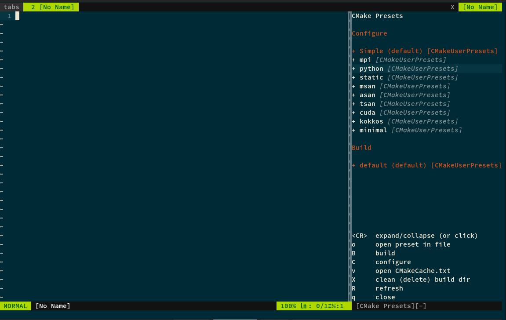
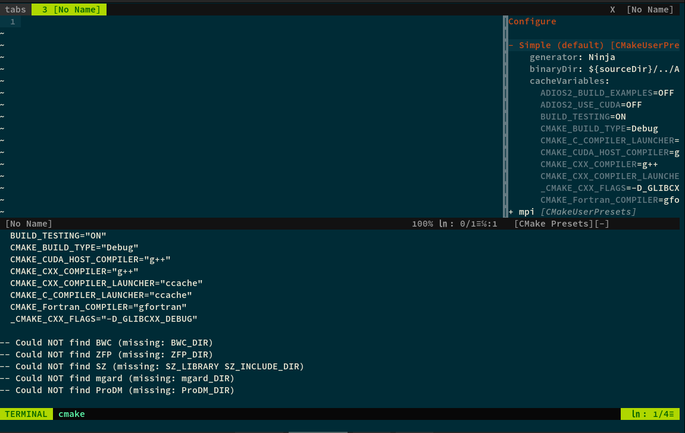

# vim-cmake-presets

A Vim sidebar that lists your CMake presets and lets you configure and build
them in a terminal split. Written in Python.



Expand a preset to see its settings, then configure it in a terminal split:



## Requirements

- Vim 8.1 or newer built with `+python3` and `+terminal`
- CMake 3.21 or newer for presets version 3

## Install

With [vim-plug](https://github.com/junegunn/vim-plug):

```vim
Plug 'vicentebolea/vim-cmake-presets'
```

With Vim's built-in packages:

```sh
git clone https://github.com/vicentebolea/vim-cmake-presets \
  ~/.vim/pack/plugins/start/vim-cmake-presets
```

Then run `:help cmake-presets` for the manual. Neovim is not supported.

## Usage

Open the sidebar with `:CMakePresets` or `<F8>` (press again to close). It
reads `CMakePresets.json` and `CMakeUserPresets.json`, including `include`d
files, and lists configure and build presets with the file each comes from.

| Key    | Action                                           |
|--------|--------------------------------------------------|
| `<CR>` | expand or collapse the preset settings (or click)|
| `B`    | build                                            |
| `C`    | configure                                        |
| `o`    | open the file defining the preset                |
| `v`    | open the preset's `CMakeCache.txt`               |
| `X`    | delete the build directory (asks first)          |
| `R`    | refresh                                          |
| `q`    | close                                            |

The `default` preset is shown in red.

## Options

```vim
let g:cmake_presets_map = '<F9>'   " toggle key, default <F8>, '' disables
```

## Tests

```sh
python3 -m unittest discover -s tests
```

## Releases

Releases are automated with semantic-release, commits use
[Conventional Commits](https://www.conventionalcommits.org/) (`fix:` for a
patch, `feat:` for a minor, `feat!:` or a `BREAKING CHANGE:` footer for a
major). Pushing to the `release` branch tags the version, updates
`CHANGELOG.md`, publishes a GitHub release and merges it back into `main`.

## Author and license

Written by Vicente Adolfo Bolea Sanchez. Released under the MIT license, see
`LICENSE`.
